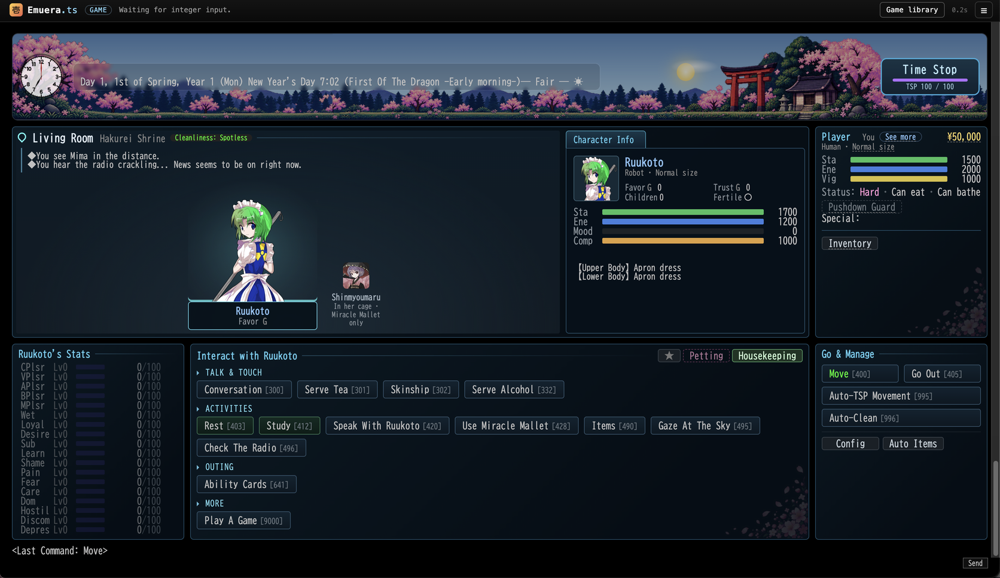
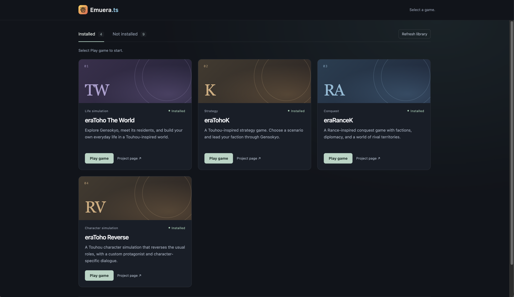

# Emuera.ts

A browser-based interpreter for Emuera/ERB games, written in TypeScript.
It hot-patches the game for UI improvements and speed.





## Get started

Requires Node.js 22.6 or newer.

```sh
npm install
npm start
```

Open [http://127.0.0.1:3003](http://127.0.0.1:3003) in your browser. Add games
under `GAMES/`, then choose **Refresh library** in the app.
I recommend starting with:

https://gitgud.io/Legis1998/anon-tw/-/archive/anon-tw_eng-modding/anon-tw-anon-tw_eng-modding.zip

(On macOS, use `unar` to extract the ZIP file to preserve Japanese filenames)

See the [developer guide](docs/developer-guide.md) for compatibility details and
additional documentation. For UI and artwork consistency, see the
[visual design guidelines](docs/visual-design-guidelines.md).

With the game input focused, press Up/Down to browse typed inputs and clicked commands.
Going past the newest entry restores your unfinished input. History lasts until
the page is reloaded. Recalled commands show their button label as a non-editable
hint (for example, `400 [Move]`); editing the input hides the hint.

## Midday saves (TW)

In TW, use **Quicksave** below **Config** at the main command screen. **Quickload**
restores the current day's game data and temporary stats, then rebuilds the main
screen without starting another
day. Both actions are also in the quick/controller menu, not the burger menu.
Each game has one quicksave slot; Quicksave replaces it immediately.

Returning to the main command screen also quicksaves automatically if no native
or quicksave has been written in the last four minutes. With no existing saves,
the four-minute timer starts when the run starts. It waits for a safe command
screen rather than interrupting an event or saving while you sit in a menu.

**Continue** above **New game** loads the most recently modified native game
save (including autosaves), unless the midday quick save is strictly newer.
It uses midday when that is the only save, and is disabled when neither exists.
Global data is not a game save. Invalid or incompatible saves report an error.

The separate `midday.erasuspend` file lives in the game's save directory and
survives app restarts. It is not a native Emuera `.sav` file. Script, display and
debug-mode edits no longer invalidate it: loading uses the current scripts and
normal game-version compatibility rules. It runs load hooks, not morning
initialization; unsaved routine locals, random sequence and the old screen are
not restored. Older frozen quicksaves are converted to game data on load.
Incompatible or damaged saves report an error. Keep regular game saves for
native Emuera. Other games and saves inside ongoing events are not
supported yet.

## Translation and clipboard

Both options below are off by default and available under **Settings…**:

- **Auto-copy game text** copies the latest printed output as plain text, before
  translation, for tools such as Luna Translator. Desktop builds use the native
  clipboard; browser builds need clipboard permission and may require focus.
- **Settings… > Translation model…** configures a local OpenAI-compatible server. In LM
  Studio, load your model (for example Gemma 3 12B), start its API server, set the
  base URL to `http://127.0.0.1:1234/v1`, and use **Load models** to select its ID.
  Save, then turn on **Local-model translation**. Translations appear below the
  game output without changing game buttons or saves. Original text is sent only
  to the configured localhost server. New output cancels an outdated translation.

These settings are saved in the current browser. Local-model translation uses
separate settings from character chat and disables the browser's on-device
translation when switched on. **Translate Japanese** remains available for
browsers with the on-device Translator API.

## Desktop builds

The Electron desktop app bundles the interpreter but not third-party games.
The Windows ZIP build looks for games in `GAMES/` beside the executable and in the
app's application-data directory (`%APPDATA%\era-typescript\GAMES` on Windows).
Extract the whole ZIP to a writable folder, then run `emuera-ts.exe`. On first launch,
it automatically downloads and extracts eraToho The World into the adjacent
`GAMES/` folder using the same installer as the library button. An existing TW
installation in either location is kept; nothing is overwritten. Failed downloads
show an error and can be retried from the library or by restarting the app.
Other game downloads also go beside `emuera-ts.exe`; Mac and Linux downloads use
application data. If the same game is in both locations, the download location takes precedence. Refresh the library
after adding games manually. Saves remain in each game's normal save directory.
Packaged desktop builds check GitHub for a newer release at startup and offer to
open its release page. The update is downloaded and installed manually.

Install dependencies with `npm install`, then build on the target operating
system:

```sh
npm run dist:mac
npm run dist:win
npm run dist:linux
```

`dist:mac` produces macOS DMG and ZIP packages for the Mac's native architecture;
`dist:win` produces `EraTs-<version>-win-x64.zip` containing the Windows x64 app;
`dist:linux` produces `EraTs-<version>-linux-x64.tar.gz` containing the Linux x64
app, including its Electron runtime. The Linux archive does not need Node.js,
Proton, or AppImage/FUSE tooling on the destination machine. There is no Windows
installer or self-extracting executable. Build
on the target OS and architecture: the graphics libraries need platform-specific
native bindings, so a Windows package built with Mac dependencies will not run.
Build Linux packages on an x64 Linux machine; CI uses Ubuntu 22.04.
Use `dist:mac:x64` on an Intel Mac or `dist:mac:arm64` on Apple silicon.
Packaging rejects mismatched targets and checks that the native libraries load.
Outputs go to `release/`. For distribution outside personal use,
sign/notarize the macOS app and sign the Windows executable.

To build and publish a GitHub Release automatically, first commit your changes,
then run:

```sh
npm run release -- patch
git push --follow-tags
```

Use `minor`, `major`, or an explicit version such as `0.2.0` instead of `patch`
as needed. The release command updates `package.json` and `package-lock.json`,
commits them, and creates a matching tag such as `v0.1.1`. It requires a clean
working tree. Pushing the tag triggers GitHub Actions to build Windows, macOS,
and Linux packages and attach them to a GitHub Release. Package filenames use
that version. The workflow uses separate Windows x64, Linux x64, macOS Intel,
and macOS Apple-silicon runners and checks native bindings inside each packaged
app before publishing.
The command does not push anything automatically.
You can also run **Build and publish desktop releases** manually from the
repository's Actions tab to build downloadable workflow artifacts without
creating a release (select a branch rather than a release tag).

To run the desktop app during development, use `npm run desktop`. This builds
the server and opens the app window.

### Steam Deck / Linux

1. Switch the Steam Deck to **Desktop Mode**.
2. Download `EraTs-<version>-linux-x64.tar.gz` from the GitHub Release and extract
   the entire archive to a folder in your home directory. Keep all extracted
   files together; do not move just the executable.
3. Open Steam, choose **Games > Add a Non-Steam Game**, and browse to the
   extracted `emuera-ts` executable. Select **All Files** if it is not listed.
4. In the shortcut's properties, set **Start In** to the folder containing
   `emuera-ts`. Leave **Force the use of a specific Steam Play compatibility
   tool** unchecked: this is a native Linux app.
5. Launch it, then use the library's download button to install a game, or add
   games manually and choose **Refresh library**. Linux does not perform the
   Windows build's automatic starter-game download.
6. Return to **Gaming Mode** and launch the shortcut. Use a mouse/trackpad Steam
   Input layout with left-click and Enter bindings. **Steam + X** opens the
   on-screen keyboard for typed commands.

Launching through Steam automatically starts the app fullscreen, including
non-Steam shortcuts in Desktop Mode and Gaming Mode. Launching directly stays
windowed. Detection uses Steam's `SteamGameId` or `SteamAppId` environment
variables; no launch options or Steamworks integration are needed.

Desktop windows fit the display's available area, including the Deck's
1280 x 800 screen. During gameplay at viewport heights of 800 px or less, the
header is hidden and a floating burger button keeps the menu accessible.
Errors appear in a bar at the top, beside the menu button.
The command row stays available for typed commands and separate text or
numeric-amount prompts. Click or press Enter to continue during pauses.
Small-screen layouts hide the inline interaction history, use smaller
watch-button text, and keep action headings inline to save space.
Number-hidden action tiles retain a 36 px minimum height with centered labels.
At compact widths of at least 1000 px, the home/shop screen is bounded to the
viewport and long panels scroll independently. Setup and character-sheet tabs
keep focus when their contents redraw.
The room panel uses content height in compact layouts; occupant names are white
with a dark outline for contrast over portraits.
The library retains its header. The menu stays within the viewport and scrolls
when needed; **Game library** remains available there.

**Settings…** opens the display, character, LLM, clipboard, and translation
controls in a scrollable dialog. Font selection and colors remain configurable;
use the browser's zoom controls to change text and interface size. Layouts adapt
automatically to the viewport, without a separate device mode or font-size setting.

At viewport sizes of 1280 x 800 px or less, or when a touch pointer is available,
named game buttons hide their bracketed command numbers. Number-only buttons
remain visible; command values and typed-input history are unchanged.
With touch input, Up/Down in the command field move focus
instead of recalling typed-input history.
When a command-number button has a separate tile label, its hidden-number control
covers the whole tile without leaving a blank gap or a separate focus outline.
In every layout, keyboard focus outlines only the labeled tile, not its inner
command-number button.
The Load game dialog initially focuses the first selectable save on the page,
or Close if the page has no saves.
Load, save, and delete use 10 manual slots per page (20 pages), with autosave
available separately. The picker opens on the page containing the last selected
manual slot (for example, slot 113 is on Page 12). Previous/Next retain focus after paging; L1/R1 page backward
and forward with controller hints. Compact GUI screens remove outer gutters.
When a separate text or amount prompt appears, focus moves into its input field.
Compact relationship actions use uniform-height buttons with one clear focus ring.

Keyboard navigation works on every platform, so it can be tested on a Mac:

- Outside text fields, arrow keys move focus between visible controls in the
  current game screen, library, menu, or dialog. Left/Right stay within the
  current visual row when possible, then reach nearby controls in the next
  panel. Up/Down prefer the same column and use a position 20% from the left
  edge to align unequal-width buttons. Down from the bottom controls reaches
  the game input; movement does not wrap.
- **Enter** activates a focused button or link; **Escape** closes menus and
  dialogs. Confirmation dialogs keep Cancel as their initial selection.
- In the game input, Up/Down still browse command history and Left/Right still
  move the cursor on non-touch devices. On touch devices, Up/Down move focus
  between controls instead of recalling command history. Press **Escape** to leave the input, then use arrows to choose
  a command. Arrow navigation remains active after choosing a command; click the
  input or type to return to text entry.
- **Tab / Shift+Tab** remain available. Games requesting raw mouse/key events
  keep their existing key handling rather than using arrow navigation.

For navigating game screens through Steam Input, the D-pad can be mapped to
arrow keys, A to Enter, and B to Escape, keeping the trackpad as a mouse for
complex screens. The centered menu and dialogs also support direct controller
input as described below.

The controller's **Menu/Start** button opens a centered menu with **Restart,
Library, Settings, and Exit** when Steam exposes a standard-mapped gamepad.
No custom keyboard mapping is required for that button. **F10** opens the same
menu for keyboard testing (some Macs need Fn+F10). Press Menu/Start again or
Escape to close it. While a dialog is open, the controller D-pad navigates,
A confirms a focused button, and B goes back. These bindings also work in
Settings and confirmation dialogs; editable fields keep their native behavior.
Game dialogs such as Inventory, Calendar, character sheets, and new-game setup
also accept direct D-pad/A/B input. Controller hints show **B** on Close/Cancel
and **A** on the focused button or link: A activates that focused control, not
an unfocused Save/Accept button. Checkboxes can also be toggled with A.
With a standard-mapped controller connected, **Y** activates **Wake Up** or
**Time Stop / Resume**, whichever is available on the current screen. A circular
**Y** hint appears on that button. Holding Y does not repeat the action; release
it before pressing again. The shortcut is inactive while menus/dialogs are open,
the game is busy, or the action is unavailable. **X** activates the **Repeat** button
at the right of the action filters to repeat the last game action (not a menu or
filter change). It uses the game's normal availability checks, requires release
between presses, and only works on the main action screen, under the same
conditions as Y. The button is hidden until there is a previous action; its X
hint appears whenever controller hints are enabled.
The repeat-arrow artwork lights up on hover, focus, and activation.
Detection uses the Gamepad API,
not the screen size or Steam launch status; browsers may require a controller
button press before exposing the connected device. The hint disappears when
the last supported controller disconnects, unless Steam Deck is detected or
hints are explicitly set to On.
**Settings > Controller hints** cycles through **Auto**, **On**, and **Off**.
Auto (the default) detects a gamepad or Steam Deck, On shows hints without a controller
for testing, and Off hides them even with a controller connected. The choice is
saved and only affects hints, not controller input. F10 remains available for
testing the centered menu. Compact Settings uses a two-column layout
to fit the Steam Deck's 1280×800 screen without scrolling; smaller screens can
still scroll to keep every setting accessible.
Responsive layouts also adapt artwork dialogs and character-sheet gauges.
Long inventories, character
lists, and history still scroll inside their panels; headers and close controls
remain accessible. Text maps fit their available space while their destination
list retains normal-sized controls.

LLM configuration is unavailable when the viewport is both at most 1280 pixels
wide and at most 800 pixels high. Its Settings
and chat configuration buttons are hidden, and resizing an open configuration
dialog down to that size closes it without saving. Larger screens retain the
full configuration form.
Restart, Library, and Exit retain unsaved-progress confirmations. Exit quits
the desktop app and is disabled with an explanation in browser builds.
The STEAM and “…” buttons remain reserved for Steam. A Steam Input layout that
exposes only keyboard/mouse events cannot be detected as a gamepad; actual Deck
default-layout compatibility still needs testing. Opening this menu does not
pause interpreter timers or background tasks.

**Settings… > Character Interaction History** controls the selected character's
history and chat panel. It defaults off when launched through Steam and on
elsewhere; a saved manual choice overrides that default. Turning it off removes
the panel and cancels active chat generation without deleting recorded history.
Game output scrollback, typed command history, and background character
reactions retain their existing behavior.

**Conformance demo** includes an **Artwork demo** button above its output for
previewing location, season, weather, and time without opening another page.

Linux downloads go to `~/.config/era-typescript/GAMES` (or
`$XDG_CONFIG_HOME/era-typescript/GAMES` when configured). The app also searches
`GAMES/` beside `emuera-ts`, with the application-data copy taking precedence.
Saves remain inside each game, so keep manually added game folders writable.

On other Linux desktops, run `./emuera-ts` from the extracted folder.
If the executable permission was lost during copying, run `chmod +x emuera-ts`.
The archive uses system desktop libraries, including GTK 3 and NSS; install
missing libraries with your distribution's package manager if launch reports
them. Do not disable Electron's sandbox to work around launch errors.

## Save files

The app reads and writes Emuera's native binary saves, including gzip-compressed
saves. Existing slots appear in the game's normal load menu without importing
or moving files.

It follows the game's `emuera.config`: saves live in `sav/` when
`セーブデータをSAVフォルダ内に作成する:YES`, otherwise in the game directory.
Slots use `save00.sav`, `save01.sav`, etc.; global data uses `global.sav`.
Character exports use `dat/chara_<name>.dat`.

**Back up your saves before switching engines.** Saving or deleting a slot here
affects the same files Emuera uses. Do not run both engines against the same
saves simultaneously. Older text-format Emuera saves and this app's previous
JSON saves are not supported.

## License

The original Emuera.ts project source is licensed under the [BSD 3-Clause
License](LICENSE.md). Bundled games and third-party assets are excluded and
remain subject to their respective licenses and terms.
