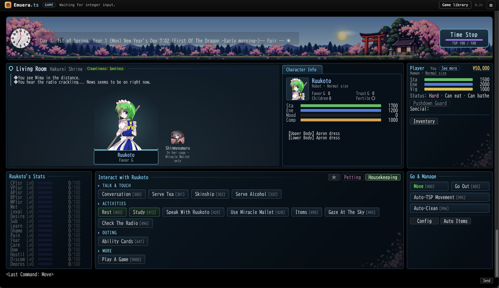
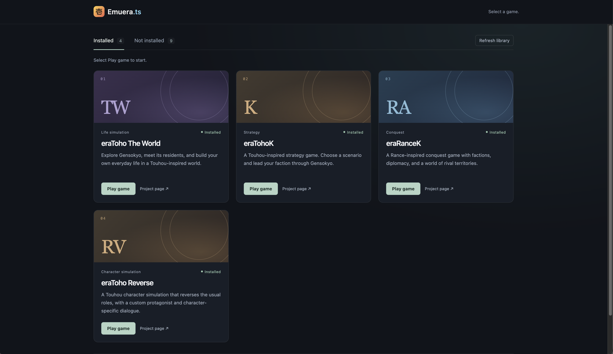

# Emuera.ts

A browser-based interpreter for Emuera/ERB games, written in TypeScript.
It hot-patches the game for UI improvements and speed.





## Get started

Requires Node.js 22.6 or newer.

```sh
npm install
npm start
```

Open [http://127.0.0.1:3000](http://127.0.0.1:3000) in your browser. Add games
under `GAMES/`, then choose **Refresh library** in the app.
I recommend starting with:

https://gitgud.io/Legis1998/anon-tw/-/archive/anon-tw_eng-modding/anon-tw-anon-tw_eng-modding.zip

(On macOS, use `unar` to extract the ZIP file to preserve Japanese filenames)

See the [developer guide](docs/developer-guide.md) for compatibility details and
additional documentation.

## Save files

The app reads and writes Emuera's native binary saves, including gzip-compressed
saves. Existing slots appear in the game's normal load menu without importing
or moving files.

It follows the game's `emuera.config`: saves live in `sav/` when
`セーブデータをSAVフォルダ内に作成する:YES`, otherwise in the game directory.
Slots use `save00.sav`, `save01.sav`, etc.; global data uses `global.sav`.
Character exports use `dat/chara_<name>.dat`.

**Back up your saves before switching engines.** Saving or deleting a slot here
affects the same files Emuera uses. Do not run both engines against the same
saves simultaneously. Older text-format Emuera saves and this app's previous
JSON saves are not supported.

## License

The original Emuera.ts project source is licensed under the [BSD 3-Clause
License](LICENSE.md). Bundled games and third-party assets are excluded and
remain subject to their respective licenses and terms.
